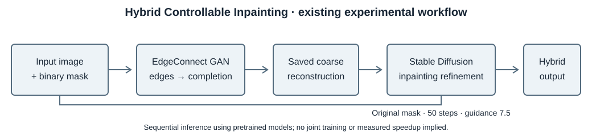
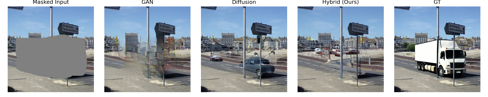
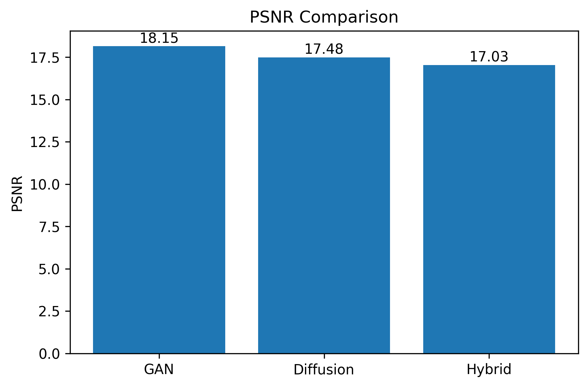
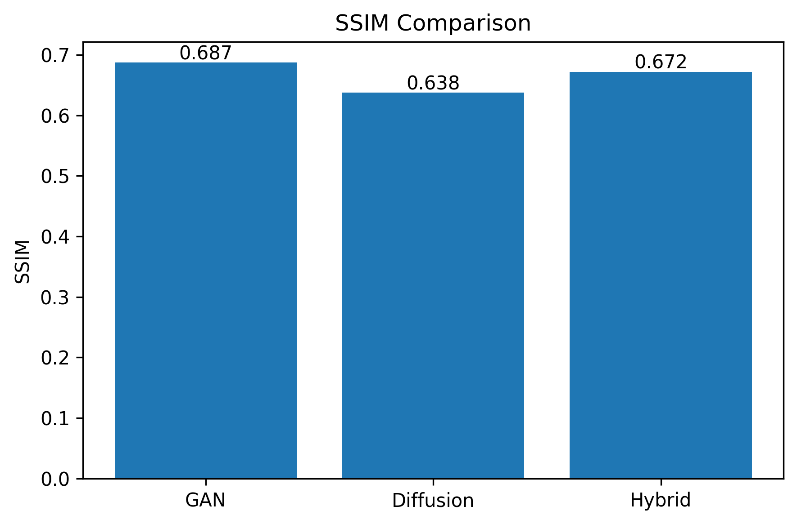
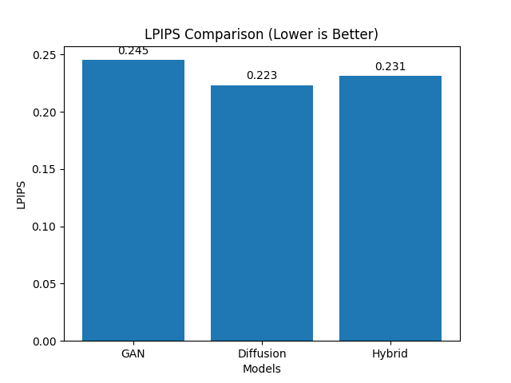

# Hybrid Controllable Inpainting

**Integrating Diffusion and GAN Mechanisms for Efficient Image Restoration**

Undergraduate thesis research comparing an EdgeConnect GAN baseline, a pretrained Stable Diffusion inpainting baseline, and a sequential GAN → diffusion pipeline. This repository reorganizes the existing experimental implementation; it does not introduce a rewritten model or a jointly trained hybrid network.

## Motivation and architecture

GAN reconstruction and diffusion synthesis offer different balances of structural fidelity and perceptual quality. The hybrid experiment explores using a GAN reconstruction as the input to diffusion refinement. The thesis title describes the research objective; this repository does not establish a measured efficiency advantage or universal improvement over either baseline.



1. EdgeConnect predicts edges and completes the masked input.
2. GAN outputs are saved as numbered PNG files.
3. The hybrid loader reads those GAN results and the corresponding masks.
4. Stable Diffusion inpainting refines each image using the original hybrid prompt, 50 steps, and guidance scale 7.5.

Refinement uses the existing `StableDiffusionInpaintPipeline` call. It is a sequential pipeline using saved images, not a custom diffusion sampler, strength-controlled restoration algorithm, or joint GAN/diffusion training procedure. White mask pixels indicate the region to inpaint.

## Installation

Use a Python environment compatible with your selected PyTorch/CUDA and Diffusers versions. The original exact package versions were not recorded; `requirements.txt` consolidates the direct dependencies but is **not a validated environment lockfile**.

```sh
python -m venv .venv
# Windows PowerShell: .venv\Scripts\Activate.ps1
# Linux/macOS: source .venv/bin/activate
python -m pip install --upgrade pip
python -m pip install -r requirements.txt
python scripts/check_repository.py
```

Install a matching `torch` / `torchvision` pair for your hardware if the default package installation is unsuitable. CUDA is selected automatically when available; CPU is supported by the inference code but full diffusion inference has not been validated in this cleanup. See [validation](docs/validation.md) for what was actually tested.

Run the following commands from the repository root. Module execution (`python -m ...`) is intentional and avoids import collisions with the isolated EdgeConnect package.

## Dataset setup and the fixed split

The original exporter uses [phiyodr/InpaintCOCO](https://huggingface.co/datasets/phiyodr/InpaintCOCO), test split, and preserves these mappings:

- `coco_image` → `images/NNNN.png`
- `mask` → `masks/NNNN.png`, converted to grayscale and thresholded at **>10**, producing 0/255 masks
- `inpaint_image` → `gt/NNNN.png`

The target is the dataset's edited `inpaint_image`, not an assumed original, uncorrupted photograph. Interpret restoration metrics with that target definition in mind.

```sh
python -m src.utils.export_dataset --output-dir data/InpaintCOCO_export
```

Do not re-export over an existing experimental dataset unless you intend to replace it. The original dataset revision was not recorded; `--revision` allows a confirmed revision to be specified for future exports. Current dataset ordering must be checked against the original export before claiming exact reconstruction of the experiment.

`splits/test_100.txt` is the **byte-for-byte original manifest**, with the same 100 samples in the same order. Each row contains input, mask, and target paths relative to the exported dataset root. It is not a newly randomized split. The GAN wrapper passes its input/mask paths directly as lists; no committed absolute `.flist` files are needed. The exporter retains its original full-dataset local flist generation, but those files are ignored.

## Pretrained models

Place the verified EdgeConnect generator files in `checkpoints/edge_connect/`:

```text
EdgeModel_gen.pth
InpaintingModel_gen.pth
```

Discriminator files are used for training, not required for inference. The four local checkpoint files are excluded from Git. Their specific dataset/training provenance is **not yet confirmed**; no download URL is asserted to reproduce these weights. Sizes and checksums are recorded in [the checkpoint inventory](docs/checkpoint_inventory.json).

Both diffusion paths retain the original identifier `runwayml/stable-diffusion-inpainting`. Access to that identifier could not be verified during cleanup (the model-page request returned HTTP 401). Use `--model /path/to/verified/local/model` when needed. Do not silently substitute a different model. Diffusion weights, model revisions, VGG19 weights used by EdgeConnect losses, and LPIPS/AlexNet weights are not bundled. See [pretrained model notes](docs/pretrained_models.md).

## Inference

Validate the GAN launch configuration without model imports, downloads, or inference:

```sh
python -m src.gan.run_edgeconnect --dry-run
```

Run the three approaches:

```sh
python -m src.gan.run_edgeconnect --mode test
python -m src.diffusion.run_sd_inpaintcoco
python -m src.hybrid.run_hybrid
```

Defaults write to `results/gan_inpaintcoco/`, `results/sd_inpaintcoco/`, and `results/hybrid_inpaintcoco/`. The hybrid command requires the GAN results first and preserves the original behavior of skipping existing output filenames. Use a separate output directory for a new experiment. GAN and diffusion baseline commands may overwrite matching output images.

Paths are configurable, for example:

```sh
python -m src.gan.run_edgeconnect --data-root data/InpaintCOCO_export --list-file splits/test_100.txt --checkpoints checkpoints/edge_connect --output-dir results/gan_new
python -m src.hybrid.run_hybrid --gan-dir results/gan_new --mask-dir data/InpaintCOCO_export/masks --list-file splits/test_100.txt --output-dir results/hybrid_new --model /path/to/verified/model
```

The separate single-image demo retains its original **mask inversion**, unlike the batch baseline:

```sh
python -m src.diffusion.baseline_sd_inpaint --image /path/to/input.jpg --mask /path/to/mask.jpg --output-dir results/demo
```

EdgeConnect training code is preserved. The provided configuration is test-only, with training/validation lists unset. To train, prepare a separate configuration with your training/validation image and mask lists, then use `python -m src.gan.run_edgeconnect --mode train --config configs/your_training.yml`. No diffusion or hybrid training script, training dataset, or thesis training history is supplied.

## Evaluation

The following commands create **new** files, separate from the protected historical results:

```sh
python -m src.evaluation.eval_metrics --gt_dir data/InpaintCOCO_export/gt --pred_dir results/gan_inpaintcoco --list_file splits/test_100.txt --out_csv results/metrics/new/gan_metrics.csv
python -m src.evaluation.eval_metrics --gt_dir data/InpaintCOCO_export/gt --pred_dir results/sd_inpaintcoco --list_file splits/test_100.txt --out_csv results/metrics/new/sd_metrics.csv
python -m src.evaluation.eval_metrics --gt_dir data/InpaintCOCO_export/gt --pred_dir results/hybrid_inpaintcoco --list_file splits/test_100.txt --out_csv results/metrics/new/hybrid_metrics.csv
python -m src.evaluation.compute_lpips --output-dir results/metrics/new
python -m src.evaluation.plot_metrics --metrics-dir results/metrics/historical --output-dir results/plots
```

- **PSNR ↑ / SSIM ↑:** full-image RGB values in [0,1], `data_range=1.0`; predictions are bicubically resized to target dimensions only when shapes differ. SSIM uses `channel_axis=2`.
- **LPIPS ↓:** original AlexNet LPIPS, RGB resized to 256×256 with the existing PIL default interpolation and normalized to [-1,1]. Files are paired by numeric filename prefix; `_edge`, `_masked`, and `_mask` debug outputs are excluded.
- PSNR/SSIM use the manifest; LPIPS retains the original directory-based matching and does **not** independently enforce that split. Point it at directories containing only the intended experiment's predictions.
- Original missing-pair skipping remains; check reported evaluated counts before comparing results. These are full-image metrics, not mask-only metrics.

## Historical results and qualitative example

The six CSVs under `results/metrics/historical/` are historical experimental outputs copied without regeneration. Their SHA-256 hashes and the split hash are checked by `scripts/check_repository.py`. The figures below are original saved plots, not newly computed results. The qualitative figure shows the existing selected sample `0004`; it is illustrative rather than evidence of typical performance.







Interpret the results as a **trade-off between structural fidelity and perceptual quality**. The hybrid does not universally outperform the GAN or diffusion baselines. The original experiments differ in prompts and preprocessing and do not isolate architecture as the only variable. No historical metrics were overwritten during cleanup. Image attribution/provenance still requires completion before publication; see [asset notes](assets/README.md).

## Repository layout

```text
src/
  gan/                  # Portable launcher; vendor code runs in a subprocess
  diffusion/            # Original batch baseline and single-image demo
  hybrid/               # Saved GAN output → Stable Diffusion refinement
  evaluation/           # PSNR/SSIM, LPIPS, plotting, historical-output guard
  utils/                # Export, preview, and comparison figures
third_party/edge_connect/ # Locally modified upstream code and original license
configs/gan.yml          # Effective original test configuration, portable paths
scripts/                 # Internal GAN worker and repository verification
splits/test_100.txt       # Exact original 100-sample manifest
assets/                  # Pipeline diagram + four selected historical figures
examples/                # Demo instructions; no redistributed input dataset
results/metrics/historical/ # Six immutable historical metric CSVs
docs/                    # Methods, provenance, changes, checksums, validation
```

Datasets, checkpoints, full generated outputs, virtual environments, caches, secrets, and `.local/` recovery material are ignored. Their local presence is not evidence they are included in the publication manifest.

## Reproducibility, attribution, and citation

See [reproducibility](docs/reproducibility.md), [cleanup changes](docs/cleanup_changes.md), and [third-party attribution](docs/third_party.md). Original prompts, model architecture, pipeline arguments, numeric preprocessing, and evaluation formulas are retained. Missing diffusion seeds and unrecorded dependency/model revisions limit exact replication.

Thesis title: *Hybrid Controllable Inpainting: Integrating Diffusion and GAN Mechanisms for Efficient Image Restoration*. Author, institution, completion year, thesis URL, and final citation details require the author's confirmation. `CITATION.cff` deliberately does not invent them.

Please cite the thesis and the EdgeConnect work described in the [preserved upstream README](third_party/edge_connect/README.md). The main `LICENSE` reserves original contribution rights pending the author's license selection; it does not relicense EdgeConnect (CC BY-NC 4.0), other borrowed code, pretrained weights, or dataset-derived figures.
